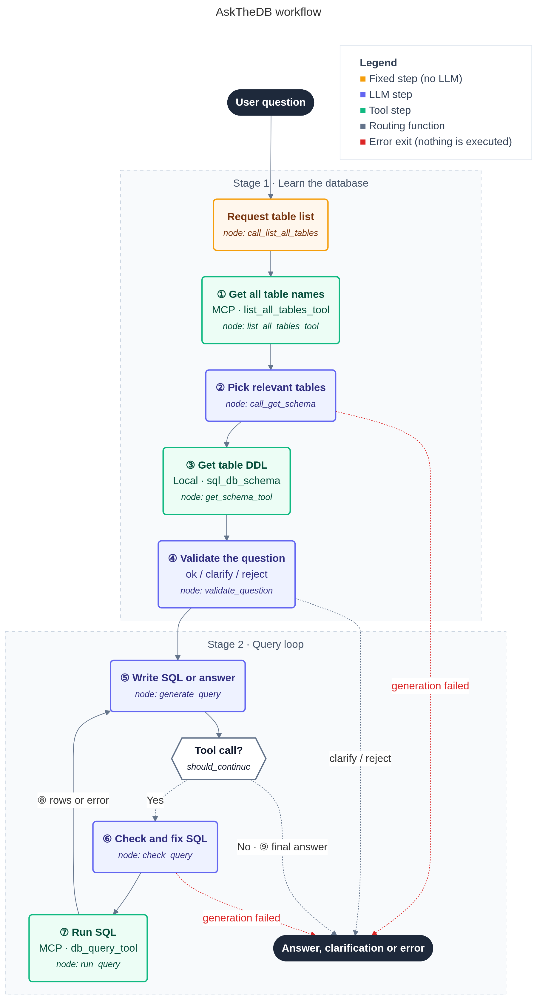

# AskTheDB

**English** | [简体中文](README.zh-CN.md)

Ask questions about a database in plain language and get answers backed by real SQL.

AskTheDB is a text-to-SQL assistant built with **LangGraph** and the **Model Context Protocol (MCP)**. A LangGraph workflow turns your question into SQL, checks it, runs it through a read-only MCP server and answers from the results. It ships with the [Chinook](https://github.com/lerocha/chinook-database) sample database (a digital music store) and works in English and Chinese.

```
You:  Which 3 artists have the most albums?
AI:   1. Iron Maiden (21 albums)  2. Led Zeppelin (14 albums)  3. Deep Purple (11 albums)
```

## Features

- **Natural-language questions**: ask in English or Chinese; the answer comes back in the same language.
- **Question validation**: before writing any SQL, the workflow checks that the question can be answered from the existing tables and columns. It asks for clarification when a question is ambiguous and explains when the data does not exist.
- **Checked SQL**: every query is reviewed against the schema by a separate step before it runs; only checked SQL is ever executed.
- **Self-correction**: when a query fails, the error goes back to the model, which fixes the SQL and retries.
- **Read-only by design**: the database is opened read-only and the MCP server accepts only a single `SELECT`/`WITH` statement.
- **Reusable MCP server**: the database tools run as a standalone MCP server that any MCP client supporting SSE can use.
- **Two interfaces**: a Gradio web chat and a command-line chat.

## How it works



1. Get the available tables
2. Pick the tables relevant to the question
3. Get the DDL of those tables
4. Validate that the question can be answered (`ok` / `clarify` / `reject`)
5. Generate a query from the question and the DDL
6. Check the query for errors
7. Run the query and return the results
8. On error, correct the query until it succeeds
9. Write the answer from the results

### Key design decisions

- **Generating a tool call and executing it are separate nodes.** The LLM (or fixed code) only decides *what* to run; a `ToolNode` runs it. This isolates errors: if generation fails, the workflow stops and nothing is executed; if execution fails, the error goes back to the LLM. It also leaves a natural checkpoint for human review between the two.
- **Checked SQL replaces the original.** The workflow state stores messages with LangGraph's `add_messages` reducer: new messages are appended, and a message with the same id replaces the old one. The SQL check reuses the original message id, so the unchecked query is overwritten and can never run.
- **Code instead of the LLM where possible.** Listing the tables is a fixed step, so plain code builds that tool call: faster, deterministic and free.

## Tech stack

| Area | Technology |
|---|---|
| Language | Python 3.11 |
| Workflow orchestration | [LangGraph](https://github.com/langchain-ai/langgraph) 0.3 |
| LLM framework | [LangChain](https://github.com/langchain-ai/langchain) 0.3 (`langchain-openai`, `langchain-community`) |
| Tool protocol | [MCP](https://modelcontextprotocol.io) Python SDK 1.6 (FastMCP, SSE transport), `langchain-mcp-adapters` |
| LLM | Qwen (default `qwen-plus`) via Alibaba Cloud Model Studio's OpenAI-compatible API |
| Database | SQLite, Chinook sample database |
| Web UI | [Gradio](https://www.gradio.app) 5 |
| Logging | [loguru](https://github.com/Delgan/loguru) |
| Workflow diagram | Mermaid, rendered via [mermaid.ink](https://mermaid.ink) |

## Project structure

```
AskTheDB/
├── mcp_server/
│   ├── mcp_tools.py        # MCP server and tools: list_all_tables_tool, db_query_tool, search_tool
│   └── start_server.py     # Starts the MCP server (SSE, port 8000)
├── sql_graph/
│   ├── askthedb_graph.py   # Builds the workflow graph (nodes that need the MCP tools)
│   ├── tools_node.py       # Schema nodes, question validation and helpers
│   ├── prompts/            # System prompts as plain-text files, loaded with load_prompt()
│   │   ├── validate_question.txt   # Decide ok / clarify / reject
│   │   ├── generate_query.txt      # Write SQL, or answer from the results
│   │   └── check_query.txt         # Review SQL for common mistakes and against the schema
│   ├── my_state.py         # Workflow state definition
│   ├── my_llm.py           # Qwen clients (LangChain chat model and OpenAI client)
│   ├── env_utils.py        # Loads settings from .env, then .env.local
│   ├── execute_graph.py    # Command-line chat (also redraws askthedb.png)
│   ├── draw_png.py         # Draws the workflow diagram
│   └── log_utils.py        # Logging configuration
├── gradio_view/
│   └── chat_gradio.py      # Gradio web chat
├── chinook.db              # Sample database
├── askthedb.png            # Workflow diagram
├── requirements.txt
└── .env                    # Settings with placeholder values (put your API key here or in .env.local)
```

## Getting started

### Prerequisites

- Python 3.11
- An API key for [Alibaba Cloud Model Studio (DashScope)](https://www.alibabacloud.com/en/product/modelstudio)

### 1. Install

```bash
git clone <your-repo-url> AskTheDB
cd AskTheDB

python -m venv .venv
# Windows (PowerShell)
.\.venv\Scripts\Activate.ps1
# macOS / Linux
source .venv/bin/activate

pip install -r requirements.txt
```

### 2. Configure

Open `.env` in the project root and replace `your-api-key-here` with your API key:

```ini
QWEN_API_KEY=your-api-key-here
```

> **Keep your key out of Git:** `.env` is part of the repository. If you plan to commit or share your copy, put your real key in a file named `.env.local` instead (same format). It is Git-ignored, and its values override `.env`.

| Variable | Required | Default | Description |
|---|---|---|---|
| `QWEN_API_KEY` | Yes | – | Model Studio (DashScope) API key |
| `QWEN_BASE_URL` | No | China (Beijing) endpoint | Must match your key's region; use the `dashscope-intl` endpoint for international keys |
| `QWEN_MODEL` | No | `qwen-plus` | Model used by the workflow |
| `LOG_LEVEL` | No | `DEBUG` | Minimum log level |

### 3. Run

The workflow talks to the database through the MCP server, so **start the server first** and keep it running.

**Terminal 1: MCP server**

```bash
python mcp_server/start_server.py
```

It listens on `http://localhost:8000/sse`. A `404` for `GET /` in its log is normal: the MCP endpoint is `/sse`.

**Terminal 2: choose an interface**

```bash
# Web chat: open http://127.0.0.1:7860
python gradio_view/chat_gradio.py

# Or: command-line chat (type q, exit or quit to stop)
python sql_graph/execute_graph.py
```

## Example questions

| Question | What it shows |
|---|---|
| How many customers are from Brazil? | Simple count |
| 专辑数量最多的歌手是谁？ | Join and group by, Chinese answer |
| 销售额最高的3种音乐类型是哪些？ | Three-table join with revenue calculation |
| What is the most popular album? | Ambiguous term: answered with a stated interpretation (highest sales) |
| 最好的歌是哪首？ | Ambiguous with no default: asks for clarification |
| What is the average age of our customers? | Data not in the database: explains what is available instead |

## Using the MCP server on its own

The server exposes three tools to any MCP client that supports the SSE transport (`http://localhost:8000/sse`):

| Tool | Description |
|---|---|
| `list_all_tables_tool` | Lists all table names |
| `db_query_tool` | Runs one read-only `SELECT` (or `WITH`) query and returns the rows, or a short error message |
| `search_tool` | Web search through Qwen, for information that is not in the database |

## Evaluation

Tested on 20 hand-written questions (7 easy, 8 medium, 5 hard; half English, half Chinese) with known correct answers:

| Metric | Result |
|---|---|
| Final-answer accuracy | 19/20 |
| SQL execution accuracy | 19/20 |
| Average time per question | about 7 s |

The question validation step stopped or clarified 10 out of 10 unanswerable or ambiguous questions, without blocking any of the 20 normal questions.

The one miss involved a playlist named `90’s Music`, written with a typographic apostrophe: the model matched the name with a plain `'`, the query returned 0, and nothing flagged it. These are small, single-run tests on a well-known sample database, so expect lower accuracy on your own data.

## Limitations and roadmap

- **Multi-turn conversations**: each question starts a new conversation, so the reply to a clarifying question loses the original context. Planned: keep conversation state with a LangGraph checkpointer.
- **Value matching**: the model sees the schema but not the actual values in each column, so text filters can miss (as in the evaluation miss above). Planned: fuzzy matching, and a tool to look up real column values.
- **Human review**: the generation/execution split leaves room for a human to approve or edit SQL before it runs; not implemented yet.
- **Retry limit**: the self-correction loop is bounded only by LangGraph's default recursion limit (25 steps).
- **Concurrency**: `search_tool` runs synchronously on the MCP server and blocks other requests while it waits for the web search.
